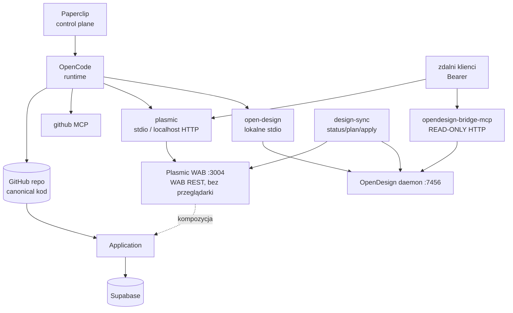

# Architektura design-stack

## Ownership

Szczegóły: skill `skills/design-stack/SKILL.md`. Zasada naczelna: jeden właściciel
na artefakt, synchronizacja jednokierunkowa (OpenDesign → kontrakt → repo → Plasmic).
Brak multi-master. (v0 usunięte z warstwy decyzją operatora — implementacje robi OpenCode.)

## Komponenty

- `services/plasmic-mcp` — 17 narzędzi `plasmic_*` (dokumentacja: `plasmic-mcp.md`).
- `services/opendesign-bridge-mcp` — 9 narzędzi `design_*`, READ-ONLY.
- `libs/*` — klienci REST + kontrakty (DesignContext, hashe, locki, idempotencja, audyt).
- `design-sync/` — `token-map.json`, `component-map.json`, CLI status/plan/apply.
- `workflows/prepare_ui_task.ts` — agregacja kontekstu + rekomendacja celu.
